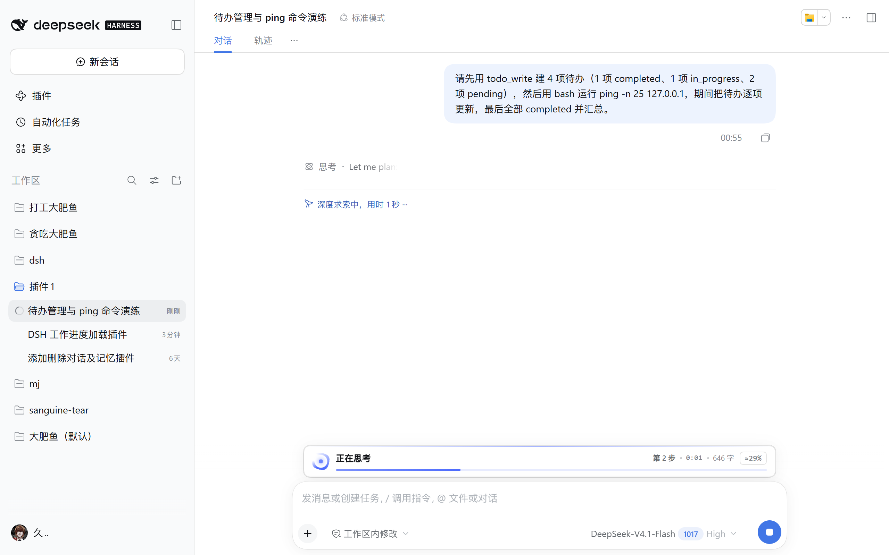
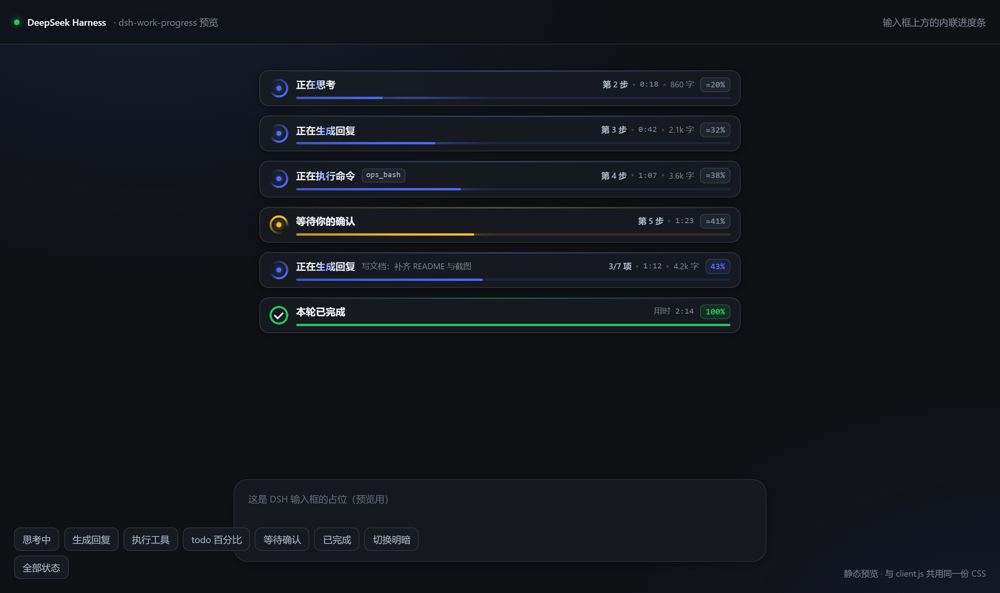
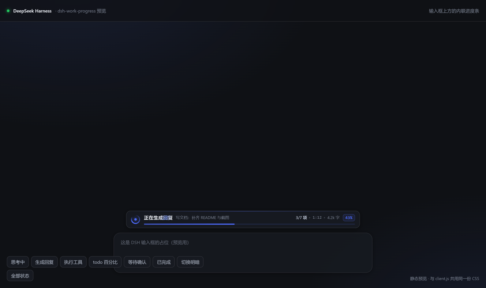

# dsh-work-progress

> 在 DSH Web 输入框上方显示实时工作进度：转圈 + 完成百分比 + 阶段 / 工具 / 计时 / 实时字数。

<p align="center">
  <a href="https://github.com/crychic-Mortis/dsh-work-progress/raw/main/dsh-work-progress-1.0.0.zip"><b>⬇️ 下载 ZIP</b></a>
  &nbsp;·&nbsp;
  <a href="#安装">安装</a>
  &nbsp;·&nbsp;
  <a href="#它显示什么">功能</a>
  &nbsp;·&nbsp;
  <a href="docs/in-dsh.png">截图</a>
</p>

给 [DeepSeek Harness](https://github.com/deepseek-ai)（DSH）Web 界面加一条**输入框上方的工作进度条**：转圈、**完成百分比**、进度条、当前阶段、第几步、正在执行的工具、已运行时间与实时生成字数，都收在一条和输入框同宽的小条里。

```
┌──────────────────────────────────────────┐
│ ◠  正在执行命令  [ops_bash]        43%   │
│     ▂▂▂▂▂▂▂▂▂▂▂▂▂▂▂▂▂▂▂▂▂▂▂▂▂▂▂▂▂▂▂▂      │
│     第 4 步 · 已运行 1:07 · 3.6k 字       │
└──────────────────────────────────────────┘
```

会话空闲时完全不渲染；一开始工作就出现，本轮结束后变成绿色对勾「本轮已完成 · 用时 X」，2.6 秒后自动淡出。





## 它显示什么

| 状态 | 文案 | 颜色 |
| --- | --- | --- |
| 模型思考 / 准备 | 正在思考 | 品牌蓝 |
| 正在流式输出正文 | 正在生成回复 | 品牌蓝 |
| 正在调用工具 | 正在执行命令 · 读取文件 · 搜索代码 · 启动子任务 … | 品牌蓝 + 工具名 chip |
| 等待你确认 / 选择 | 等待你的确认 | 琥珀色 |
| 本轮结束 | 本轮已完成 | 绿色 + 对勾 |

右上角始终显示**完成百分比**。下方一行实时显示：**第 N 步 / 3-7 项**、**已运行 0:42**、**已生成 2.1k 字**（流式正文/思考的字符数，实时增长）。

## 百分比是怎么算的

| 情况 | 显示 | 含义 |
| --- | --- | --- |
| 会话里有 todo 清单 | `43%`，下方 `3/7 项` | **真实完成比例**：已完成条目数 ÷ 总条目数；当前进行中的条目名会显示在阶段后面 |
| 没有 todo 清单 | `≈29%`（灰色） | **估算**：按本轮步数做一条递减增长曲线，只用于感知节奏，不保证准确 |
| 本轮结束 | `100%` | 本轮完成 |

DSH 本身不预知一轮任务总共要几步，所以没有 todo 时只能估算；如果希望百分比是准的，让 Agent 在长任务里用 `todo_write` 建一份待办清单即可，插件会自动按清单算真实比例。



## 交互

- 进度条**贴在输入框正上方**，和输入框同宽，不遮挡聊天内容；本轮结束时自动收起，空闲时完全不占高度。
- 没有按钮、没有设置项——只在真正干活时出现，结束 2.6 秒后淡出。
- 窄窗口（< 720px）会自动隐藏「字数」一项，给阶段文案和计时留空间。

## 数据来源与隐私

全部数据来自浏览器侧 session 作用域的**标准 Hook**，不读会话日志、不读磁盘、不发网络请求（除了一个可选的自检 `POST /work-progress/api/hello`）：

- `useSession(s => s.running)`
- `useChat(s => s.legacy.partial)` / `useChat(s => s.legacy.runningCalls)`
- `useChat(s => s.timeline)`（本轮开始时间）
- `useProjection('sessionStats')`（已完成步骤数）
- `useProjection('todos')`（todo 清单 → 真实完成百分比）
- `useSessionStatus(...)`（是否在等待确认）

宿主半端只提供一个**只读健康检查端点**：

```bash
curl http://127.0.0.1:51841/work-progress/api/health
# {"ok":true,"plugin":"dsh-work-progress","version":"1.0.0",
#  "clientComposed":true,"clientOnline":true,"helloCount":1,
#  "runningSessions":1}
```

`clientComposed` = 客户端 bundle 已进入启动图；`clientOnline` = 浏览器半端确实加载并执行了 `apply()`。两个都为 `true` 才说明插件完整生效。

## 安装

### 方式一：本机目录（开发/自用）

```bash
cd dsh-work-progress
node install.mjs --profile desktop
```

Windows 也可以直接双击 `install.cmd`。脚本会：

1. 在 `<profile>/node_modules` 建 junction / symlink；
2. 在 profile `package.json` 的 `dependencies` 写入 `file:` 绝对路径（自动备份）；
3. 在 profile `cordis.patch.yml` 末尾追加本插件的 insert 行（幂等）。

装完重启 DSH（或关闭窗口从托盘重开）。当前版本的 DSH 开着 HMR 时，改 patch 文件通常会自动热加载；没生效就重启。

### 方式二：ZIP

把 `dsh-work-progress-1.0.0.zip` 解压到任意目录，进入目录执行：

```bash
node install.mjs --profile desktop
```

### 卸载

编辑 `~/.dsh/profiles/desktop/package.json` 与 `cordis.patch.yml`，删掉 `dsh-work-progress` 相关行，再删除 `node_modules/dsh-work-progress` 链接，重启 DSH 即可。

## 兼容性

- DSH 0.2.x 的 Web 客户端（`@deepseek-ai/dsh-client-ui-chat` 提供 `conversation.input.dock` 与 `useChat` / `useSession` / `useProjection` / `useSessionStatus`）。
- 纯深/浅色主题自适应：使用 `--dsw-alias-*` 主题变量，没有写死颜色。
- 跟随系统「减少动态效果」：`prefers-reduced-motion: reduce` 时停掉旋转与流动动画。
- 不依赖 `@deepseek-ai/dsh-client-ui-primitives`，只用平台提供的 `react`，升级插件基座时不容易被图标导出改名打断。

## 开发与测试

```bash
# 语法检查
node --check client.js && node --check index.js

# 浏览器半端冒烟测试（最小 React Hook 引擎，覆盖 8 种状态/分支）
node --test test/client.test.mjs

# 生成静态预览页（复用 client.js 里的同一份 CSS）
node ../tools/make-preview.mjs
```

目录：

```
dsh-work-progress/
├─ index.js            # 宿主半端：Cordis 入口 + 只读 health
├─ client.js           # 浏览器半端：__ModuleLoader__ bundle + 输入框上方进度条
├─ cordis.patch.yml    # bundle patch
├─ install.mjs         # 安装脚本
├─ install.cmd         # Windows 双击版
├─ test/client.test.mjs
└─ README.md
```

## 已知边界

- 百分比分两种：有 todo 清单时是**真实完成比例**；没有清单时是**按步数估算**，带「≈」和灰色样式，不保证准确。DSH 的轮次没有可预知的总步数，这是不伪造精确百分比的折中。
- **同一轮内百分比只增不减**：即使中间步骤号回退、阶段切换，也保持历史最高值；同时估算值会随时间缓慢爬升，不会卡死。新一轮开始时清零重算。
- 有 todo 时百分比只在 Agent 更新条目状态时跳变（完成一项涨一截），不会平滑爬升；进行中的条目会在阶段后显示标题，配合转圈表示仍在工作。
- 「已生成字数」统计的是流式块里的字符数，不是 token；中文场景下比 token 更直观。
- 进度条挂在 `conversation.input.dock`（输入框上方的列表 slot）上，所以只在**对话页**显示；打开插件管理等全屏页面时不会出现。这是有意的，避免在非会话页面挡住内容。
- 因为它是输入框布局的一部分，出现/收起时输入框会有约 44px 的上下位移；这是为保证「不遮挡聊天内容」做的取舍。

## License

MIT
